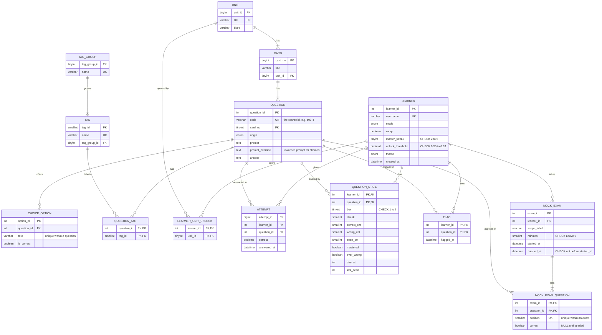

# Entity-relationship diagram

The database is MySQL, in third normal form, built by seven migrations (`db/migrations/`). It has
**14 tables** (plus `schema_migrations`, which only records which migrations were applied),
**17 foreign keys**, and **6 CHECK constraints**.

## The full diagram

GitHub draws this automatically. `PK` is a primary key, `FK` a foreign key, `UK` a unique column.
Crow's feet show how many: `||` exactly one, `o|` zero or one, `|{` one or many, `o{` zero or many.



## The same schema, small enough to draw by hand

Only the tables and how they connect. Read `A ──< B` as "one A has many B" and `B >── A` as "each B belongs to one A".
Every `<` is a foreign key stored on the table at the `<` end (the "many" side).

```
THE BANK (the course content)

  unit ──< card ──< question ──< choice_option
                       │
                       └──< question_tag >── tag >── tag_group


ONE LEARNER (progress, all pointing back at the bank)

  learner ──< attempt >── question
     │
     ├──< question_state >── question
     ├──< flag >── question
     ├──< learner_unit_unlock >── unit
     └──< mock_exam ──< mock_exam_question >── question
```

Many-to-many relationships are drawn as a junction table with `>` on both sides:
`question <-> tag` through `question_tag`, and `learner <-> unit` through `learner_unit_unlock`.
Tables whose primary key is made of two columns: `question_tag`, `learner_unit_unlock`, `question_state`, `flag`, `mock_exam_question`.

## One-line purpose of each table

| Table | Primary key | Foreign keys | What it holds |
|---|---|---|---|
| `unit` | `unit_id` | | the 13 units of the course |
| `card` | `card_no` | `unit_id` | the 52 cards; each belongs to one unit |
| `question` | `question_id` | `card_no` | the 280 questions, prompt and reference answer |
| `tag_group` | `tag_group_id` | | 4 groups of tags ("Question type", "Concepts", ...) |
| `tag` | `tag_id` | `tag_group_id` | the 35 tags |
| `question_tag` | `(question_id, tag_id)` | both | which tags label which question (many-to-many) |
| `choice_option` | `option_id` | `question_id` | the answer options of choice questions |
| `learner` | `learner_id` | | a person and their settings |
| `learner_unit_unlock` | `(learner_id, unit_id)` | both | units a learner opened by hand (many-to-many) |
| `attempt` | `attempt_id` | `learner_id`, `question_id` | the log: one row per answer |
| `question_state` | `(learner_id, question_id)` | both | where a learner stands on a question (box, streak, due) |
| `flag` | `(learner_id, question_id)` | both | questions flagged for help |
| `mock_exam` | `exam_id` | `learner_id` | one row per mock exam |
| `mock_exam_question` | `(exam_id, question_id)` | both | the questions on an exam and whether each was right |
