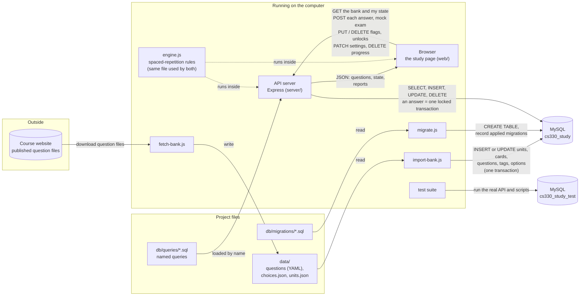

# System diagram: the database in context

Everything that reads or writes the database, and what each arrow does with the data.

**Numbers for the exam (question 2).** Mark the code you write out on the diagram:

- **1** = `db/migrations/005_create_attempt.sql`: it runs in **migrate.js**, which creates the `attempt` table **in MySQL**.
- **2** = `db/queries/attempts.sql`: it is loaded by the **API server**, which runs its queries **against MySQL** (the arrow from the API to the database).

## The life of one answer

What happens when you click an answer on the page, in order:

1. **Browser.** `app.js` grades the answer (auto for choice questions, your own click for written ones) and
   runs `engine.js` on its own copy of the state, so the screen updates instantly.
2. **Browser to API.** `remote.js` sends `POST /api/learners/me/attempts` with `{ code, correct }`. Changes go out
   one at a time, in order.
3. **API checks the input.** `server/app.js` rejects anything that is not a question code like `c07-4` and a true/false.
4. **Start a transaction.** `store.recordAttempt` begins a transaction and locks your `learner` row (`SELECT ... FOR UPDATE`),
   so two answers can never be processed at the same moment.
5. **Read.** It looks up the question, counts your earlier attempts (that count is your logical clock),
   and reads your current `question_state` row for that question.
6. **Run the rules.** It calls the same `engine.js` the browser used: wrong answer, box 1; right answer, next box;
   three right in a row, mastered; it works out when the question is due again.
7. **Write twice.** `INSERT INTO attempt` (the log) and `INSERT ... ON DUPLICATE KEY UPDATE` on `question_state` (where you stand now).
8. **Commit.** Both writes become permanent together, or neither does (a failure rolls both back).
9. **API to browser.** The new state comes back as JSON; the page keeps it (the database's answer is the one that counts).
10. **Later.** Streaks, mastery per unit, weakest topics and most-missed questions are never stored: the Dashboard
    asks the database to work them out from `attempt` and `question_state` each time (`reports.sql`, `attempts.sql`).
